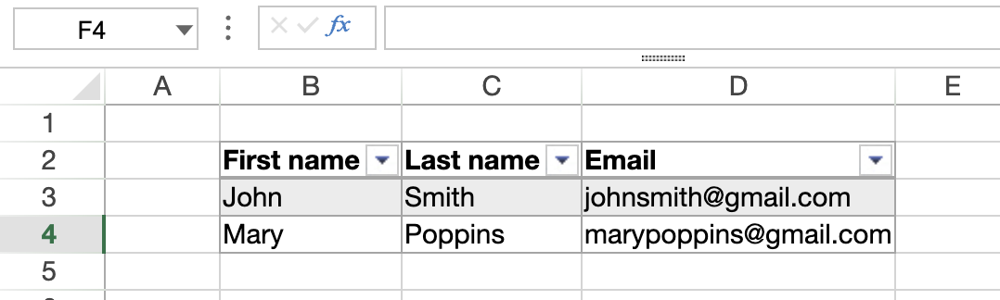

# VP CREATE TABLE


**VP CREATE TABLE** ( *rangeObj* : Object ; *tableName* : Text {; *source* : Text} {; *options* : cs.ViewPro.TableOptions} )


|Parameter|Type||Description|
|---|---|---|---|
|rangeObj|Object|->|Range object|
|tableName|Text|->|Name for the table|
|source|Text|->|Data context property name to display in the table|
|options|[cs.ViewPro.TableOptions](../classes.md#tableoptions)|->|Additional options|

## Description

The `VP CREATE TABLE` command creates a table in the specified range. You can create a table in a range of cells to make managing and analyzing a group of related data easier. A table typically contains related data in rows and columns, and takes advantage of a [data context](vp-set-data-context).



In *rangeObj*, pass the cell range where the table will be created.

In *tableName*, pass a name for the table. The name must:  

* be unique in the sheet
* include at least 5 characters
* not include spaces or start with a number

In *source*, you can pass either:

- A **data context property name** (see [VP SET DATA CONTEXT](VP%20SET%20DATA%20CONTEXT.md)): the table is bound to that property of the current data context. The *source* property must contain a collection of objects and each element represents a row.
- A **data source name** previously registered with [VP ADD DATA SOURCE](VP%20ADD%20DATA%20SOURCE.md): the table is bound directly to the DataManager table using the SpreadJS `addFromDataSource` API. No `VP SET DATA CONTEXT` call is needed.

When *source* matches a registered data source name, the DataManager binding takes priority. If both a data context property and a data source share the same name, the data source wins.

  * If you don't specify a *source*, the command creates an empty table with the size defined in *rangeObj*. 
  * If the specified *source* cannot be fully displayed in the document, no table is created.

In the *options* parameter, pass an object of the [`cs.ViewPro.TableOptions` class](../classes.md#tableoptions) that contains the table properties to set. 

Within the *options* object, the *tableColumns* collection determines the structure of the table's columns. The length of the *tableColumns* collection must be equal to the range column count:

  * When the column count in *rangeObj* exceeds the number of columns in *tableColumns*, the table is filled with additional empty columns.
  * When the column count in *rangeObj* is inferior to the number of *tableColumns*, the table displays a number of columns that match the range's column count.

If you pass a *source* but no *tableColumn* option, the command generates columns automatically. In this case, *rangeObj* must be a cell range. Otherwise, the first cell of the range is used. When generating columns automatically, the following rules apply:

* If the data passed to the command is a collection of objects, the property names are used as column titles. For example:

```4d
([{ LastName: \"Freehafer\", FirstName: \"Nancy\"},{ LastName: \"John\", FirstName: \"Doe\"})
```
Here the titles of the columns would be `LastName` and `FirstName`.

* If the data passed to the command is a collection of scalar values, it must contain a collection of subcollections:

  * The first-level collection contains subcollections of values. Each subcollection defines a row. Pass an empty collection to skip a row. The number of values in the first subcollection determines how many columns are created.
  * The subcollections' indices are used as column titles.
  * Each subcollection defines cell values for the row. Values can be `Integer`, `Real`, `Boolean`, `Text`, `Date`, `Null`, `Time` or `Picture`. A `Time` value must be an a object containing a time attribute, as described in [VP SET VALUE](VP%20SET%20VALUE.md). 

> This only works when generating columns automatically. You cannot use a collection of scalar data with the *tableColumns* option.


## Example 1 - Using a data context

To create a table using a data context:

```4d
// Set a data context
var $data : Object

$data:=New object()
$data.people:=New collection()
$data.people.push(New object("firstName"; "John"; "lastName"; "Smith"; "email"; "johnsmith@gmail.com"))
$data.people.push(New object("firstName"; "Mary"; "lastName"; "Poppins"; "email"; "marypoppins@gmail.com"))


VP SET DATA CONTEXT("ViewProArea"; $data)

// Define the columns for the table
var $options : cs.ViewPro.TableOptions

$options:=cs.ViewPro.TableOptions.new()
$options.tableColumns:=New collection()
$options.tableColumns.push(cs.ViewPro.TableColumn.new("name"; "First name"; "dataField"; "firstName"))
$options.tableColumns.push(cs.ViewPro.TableColumn.new("name"; "Last name"; "dataField"; "lastName"))
$options.tableColumns.push(cs.ViewPro.TableColumn.new("name"; "Email"; "dataField"; "email"))

// Create a table from the "people" collection
VP CREATE TABLE(VP Cells("ViewProArea"; 1; 1; $options.tableColumns.length; 1); "ContextTable"; "people"; $options)
```

Here's the result:


## Example 2 - Using a data source

To create a table directly from a data source registered with `VP ADD DATA SOURCE` (no data context required):

```4d
// Register an in-memory collection as a data source
var $people:=[{id: 1; firstName: "Alice"; lastName: "Martin"; city: "Paris"}; \
    {id: 2; firstName: "Bob"; lastName: "Dupont"; city: "London"}]

VP ADD DATA SOURCE("ViewProArea"; $people; {name: "People"})

// Create a regular worksheet table bound to the "People" DataManager table
// The source name matches the registered data source — addFromDataSource is used automatically
VP CREATE TABLE(VP Cells("ViewProArea"; 0; 0; 1; 1); "PeopleTable"; "People")
```

The command detects that `"People"` is a registered data source and uses the SpreadJS `addFromDataSource` API. If a data context property and a data source happen to share the same name, the data source takes priority.

## See also

[VP Find table](VP%20Find%20table.md)<br/>
[VP Get table column attributes](vp%20get%20table%20column%20attributes.md)<br/>
[VP Get table column index](VP%20Get%20table%20column%20index.md)<br/>
[VP INSERT TABLE COLUMNS](VP%20INSERT%20TABLE%20COLUMNS.md)<br/>
[VP INSERT TABLE ROWS](VP%20INSERT%20TABLE%20ROWS.md)<br/>
[VP ADD DATA SOURCE](VP%20ADD%20DATA%20SOURCE.md)<br/>
[VP REMOVE TABLE](VP%20REMOVE%20TABLE.md)<br/>
[VP RESIZE TABLE](VP%20RESIZE%20TABLE.md)<br/>
[VP SET DATA CONTEXT](VP%20SET%20DATA%20CONTEXT.md)<br/>
[VP SET TABLE COLUMN ATTRIBUTES](VP%20SET%20TABLE%20COLUMN%20ATTRIBUTES.md)<br/>
[VP SET TABLE THEME](VP%20SET%20TABLE%20THEME.md)